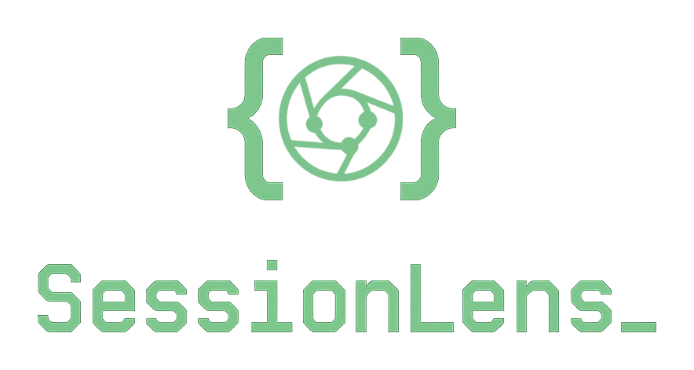
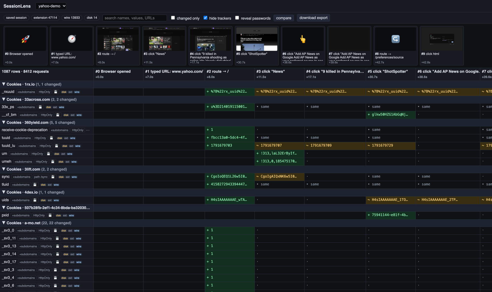
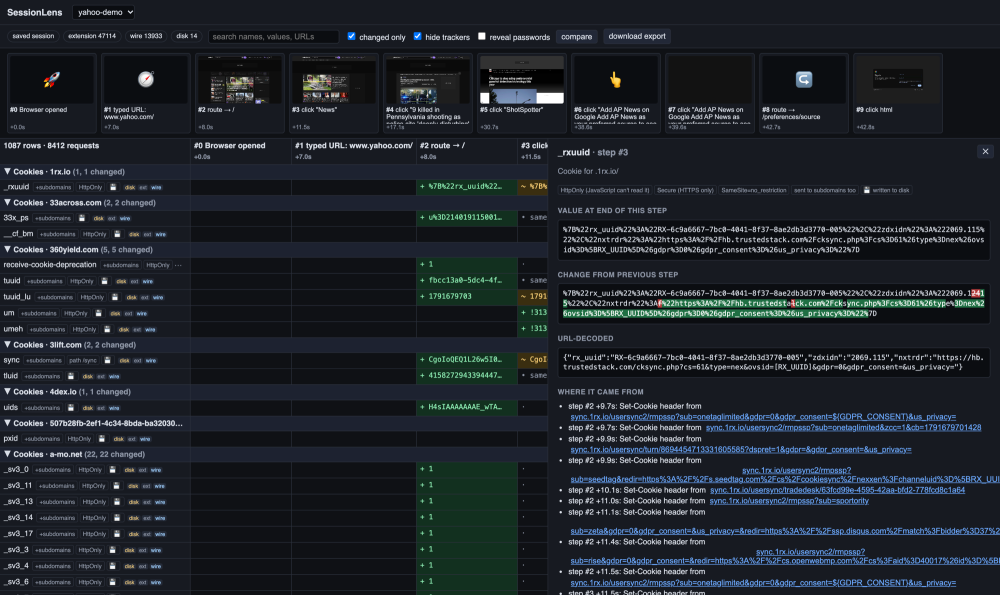
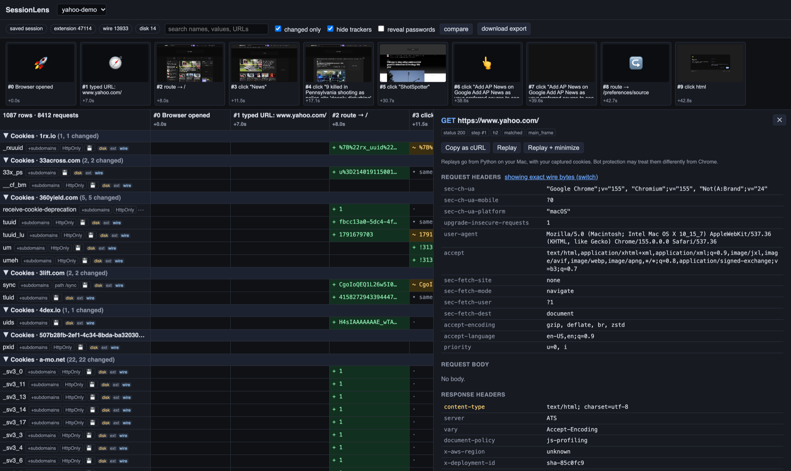
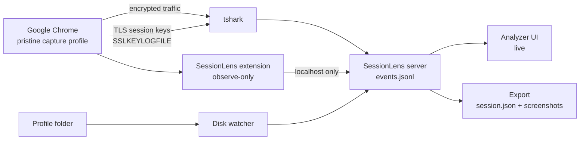

<p align="center">
  
</p>

# SessionLens

**See everything a website does while you use it — every request, cookie, storage write and file
Chrome saves — laid out step by step, in real Google Chrome, without the site being able to tell.**

SessionLens is an HTTP traffic and cookie tracking tool for macOS: a network capture and analysis
toolkit that records decrypted HTTPS traffic (HTTP/1.1, HTTP/2, HTTP/3), cookies, localStorage and
browser storage per user action. Think of it as an undetectable Chrome DevTools alternative and a
richer HAR alternative, built for web reverse engineering, privacy research and automation work.



You browse normally. SessionLens records each click, form submit and page change as a **step**, and
lines up underneath it everything that happened because of it: the requests Chrome sent, the exact
headers and bodies on the wire, which cookies appeared or changed (and which response or script
changed them), what landed in localStorage, and what Chrome wrote to disk. When you're done, you get
an interactive timeline and a clean JSON export you can feed to other tools.

> **Demo:** 48 seconds on yahoo.com — homepage, News, one article, a couple of clicks —
> produced **10 steps, 8,412 requests to 674 hosts, 743 cookies from 228 domains, 332 storage writes
> and 153 cookies Chrome blocked.** Every one of them is in the timeline above, tied to the click that
> caused it.

---

## Why not just use Chrome DevTools or a HAR file?

DevTools is great for debugging your own page. It's the wrong tool for understanding someone else's
site end to end.

| | Chrome DevTools | SessionLens |
|---|---|---|
| Can the site detect it? | Yes — open DevTools and the debugger protocol are detectable, and bot protection reacts | No debugger, no automation flags, no proxy: nothing in the page changes |
| Organised by | One flat list of requests | **Steps**: each click / submit / navigation, with its requests, cookie and storage changes |
| Cookie history | Current jar only | Every value of every cookie over time, git-diff style, with **who set it** (which `Set-Cookie` response, or page JavaScript) and **every request that sent it** |
| Blocked cookies | Hidden in a filter | Listed per request, with the likely reason (SameSite, Secure, third-party, …) |
| Survives reloads and redirects | Only with "Preserve log" | Always — the whole session is one recording |
| What reaches disk | Not shown | Cookie DB writes, cache entries, history, HSTS, service workers — per step |
| Network detail | Chrome's view | Exact decrypted bytes from the network for HTTP/1.1, h2 and h3 |
| Output | HAR (flat, huge) | A timeline JSON with screenshots, cross-referenced and ready for scripts or AI |
| Replay | Copy as cURL | Copy as cURL, **Replay**, and **Replay + minimize** (finds which headers and cookies the server really checks) |
| Compare runs | No | Side-by-side diff of two sessions |

## Features

- **Step timeline with screenshots** — one column per action, a screenshot of the page after each.
- **State matrix** — every cookie and storage key is one row with a fixed name; read across to watch it
  change: 🟢 added, 🟡 changed, 🔴 removed. Filter to *changed only*, hide trackers, search values.
- **Cookie lineage** — click a cell to see the full value, a character-level diff against the previous
  step, JWT / Base64 / URL decoding, where it came from and every request that carried it.

  

- **Request detail** — exact wire headers (or the extension's view), query parameters, decoded
  request and response bodies (gzip / br / zstd undone), cookies sent, and what each `Set-Cookie`
  did: stored, deleted, unchanged or blocked.

  

- **Hover links** — hover a cookie to light up the requests that sent it (blue) or set it (green);
  hover a request to light up its cookies.
- **Live** — the analyzer updates as you browse; open it on a second laptop on the same Wi-Fi.
- **Disk view** — what Chrome persisted per step, and which cookies were memory-only.
- **Replay + minimize** — re-send a request from your Mac, dropping headers and cookies one at a time
  to find the minimum the server accepts.
- **Export** — `session.json` timeline + screenshots + large bodies, documented in
  [docs/export-format.md](docs/export-format.md). [docs/analyzing-sessions.md](docs/analyzing-sessions.md)
  is a hands-on guide to correlating it: action → requests → cookies → where they went next.
- **Agent-ready repo** — [CLAUDE.md](CLAUDE.md) lets any AI coding agent pick up the project and
  extend it safely.
- **Clean every time** — each capture starts from a pristine Chrome profile: no cookies, cache or
  history, extension already installed.

## Where it's useful

- **Learning how the web works** — watch a login, a cookie-consent banner, an SSO redirect chain or a
  Cloudflare challenge happen, step by step.
- **Automation and integration work** — find exactly which requests, tokens, CSRF values and cookies a
  flow needs before you script it.
- **Privacy research** — see who sets what on a page: 228 cookie domains for one news homepage.
- **QA and debugging** — record a flow once and inspect it at leisure; compare two runs to see what
  changed.
- **Security testing** of your own applications, or ones you're authorised to test.
- **Feeding other tools** — the export is plain JSON designed to be read by scripts and AI models.

## Requirements

Built and tested on macOS (Apple Silicon) with Google Chrome 155, Wireshark 4.6, Python 3.12 and
Node 26. Intel Macs should work but haven't been tested.

| Tool | Why | Install |
|---|---|---|
| Google Chrome | the browser being recorded (your normal Chrome profile is never touched) | [google.com/chrome](https://www.google.com/chrome/) |
| Wireshark CLI (`tshark`, `dumpcap`) | captures and decrypts network traffic | `brew install wireshark` |
| Wireshark ChmodBPF | permission to capture without `sudo` | `brew install --cask wireshark-chmodbpf`, then log out/in or restart |
| Python 3.12 | capture server and analysis | `pyenv install 3.12` (or any 3.12) |
| Node.js 20+ | builds the analyzer UI | `brew install node` |

## Install

```bash
git clone https://github.com/vikaskoppineedi/sessionlens.git
cd sessionlens

python3.12 -m venv .venv
.venv/bin/pip install -r requirements.txt

cd web && npm install && npm run build && cd ..
```

## Use

```bash
.venv/bin/python -m sessionlens start
```

SessionLens checks the prerequisites, then starts everything in order and confirms each piece:

```
  ✅ Capture profile reset to pristine (no cookies, cache or history)
  ✅ Analyzer server listening on port 47831
  ✅ tshark capturing on en0
  ✅ Chrome launched (separate window, your normal Chrome is untouched)
  ✅ Extension connected
  ✅ TLS keys being logged
  ✅ Decryption working

  Analyzer:  http://localhost:47831/
  From another laptop on this Wi-Fi:  http://192.168.x.x:47831/

  👉 Start browsing in the new Chrome window. Quit it (Cmd+Q) when done.
```

**First run only:** Chrome opens on `chrome://extensions`. Turn on **Developer mode**, click
**Load unpacked**, choose the `extension/` folder, then quit Chrome. SessionLens saves that profile
as *pristine* and restores it before every capture. Redo it with `python -m sessionlens setup`.

Leave about 2 seconds between actions so each gets its own step and screenshot. When you quit the
capture window (Cmd+Q), SessionLens re-decodes the full capture, keeps only the browser's traffic,
writes the export, and exits. Open saved sessions later with `python -m sessionlens view`.

| Command | What it does |
|---|---|
| `python -m sessionlens start` | capture a new session |
| `python -m sessionlens view` | open the analyzer on saved sessions |
| `python -m sessionlens export <id>` | rebuild a session's export folder |
| `python -m sessionlens setup` | redo the one-time capture profile setup |

Captures are saved to `~/sessionlens-captures/<session-id>/`. Change it with
`SESSIONLENS_CAPTURES=/path/to/folder`.

## How it works



| Layer | Source | Adds |
|---|---|---|
| Network | `tshark` decrypting the capture with Chrome's TLS key log | exact request/response headers and bodies, HTTP/1.1, h2, h3 |
| Browser | extension: `webRequest` (observe-only), `cookies`, `webNavigation` | which tab made each request, every cookie change and its cause |
| Actions | content script in Chrome's isolated world, listen-only | clicks, submits, Enter; localStorage / sessionStorage; screenshots |
| Disk | polling the capture profile | cookies written to disk, cache, history, HSTS, network state, service workers |

Nothing touches the page: no debugger, no `--remote-debugging`, no automation flags, no proxy (so
the TLS fingerprint is Chrome's own), and the extension never modifies the DOM or page JavaScript.

## Limits

- What page JavaScript *computes* (a signed token, say) is visible as its result; read the script to
  see how. Watching code run needs the debugger, which sites can detect.
- Blocked-cookie reasons are inferred from the cookie's attributes — Chrome doesn't tell extensions.
- Chrome writes cookies to disk about every 30 seconds, and session cookies never.
- Replays are sent from Python, whose TLS fingerprint differs from Chrome's; bot protection may answer
  differently.
- macOS only (capture interface, Chrome paths, permissions).

## Responsible use

Use SessionLens on your own accounts and on sites you're allowed to test, and respect each site's
terms of service.

Captures contain **live session tokens, TLS keys and full packet captures**, and the raw
`events.jsonl` includes anything you typed into forms. They're stored outside the repository with
owner-only permissions; never share them. The export masks password fields, security answers and
one-time codes, but cookie values in it are real.

The analyzer listens on all interfaces **without a password** so you can open it from another device.
Run it on trusted networks only, and stop it (Ctrl+C) when you're done.

## Development

Using an AI coding agent? [CLAUDE.md](CLAUDE.md) gives it the project layout, commands, conventions
and design rules. It works with Claude Code, Codex, Cursor, Copilot, Aider and similar tools.

```bash
.venv/bin/pytest && .venv/bin/ruff check . && .venv/bin/mypy
node --test extension/lib.test.js
cd web && npm test && npm run lint && npm run typecheck
cd web && npm run dev      # UI dev server, proxies /api to a running SessionLens
```

```
extension/     Chrome extension (observe-only recorder)
sessionlens/   capture orchestration, tshark parsing, analysis model, export, web API
web/           analyzer UI (React + TypeScript)
tests/         pytest suite (with a real decrypted tshark fixture)
docs/          export format, screenshots
```

## License

[MIT](LICENSE)
