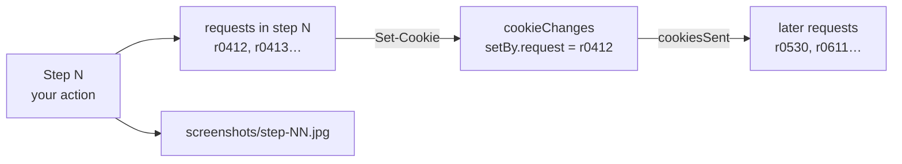

# Analyzing a session

A hands-on guide to reading a SessionLens export and connecting the dots: which action caused which
requests, which response set which cookie, and where that cookie went next.

Everything here works on `export/session.json` (format: [export-format.md](export-format.md)).
The analyzer UI shows the same data visually; this guide is for when you want to dig, script or
search. Examples use [`jq`](https://jqlang.org) (preinstalled on macOS 15+, or `brew install jq`).

```bash
cd ~/sessionlens-captures/<session-id>/export
```

## 1. The mental model



Three keys tie everything together:

| Key | Looks like | Connects |
|---|---|---|
| step number | `4` | action ↔ requests ↔ cookie/storage changes ↔ `screenshots/step-04.jpg` |
| request id | `r0412` | a request ↔ the cookie changes it caused (`setBy.request`) |
| cookie key | `.yahoo.com A1` | a cookie's changes ↔ every request that sent it (`cookiesSent`) |

A leading dot in a cookie key (`.yahoo.com`) means the cookie is also sent to subdomains.

## 2. Start with the timeline

```bash
jq -r '.steps[] | "\(.step)\t\(.atMs)ms\t\(.label)\t\(.screenshot // "-")"' session.json
```
```
0   0ms       Browser opened              -
1   6995ms    typed URL: www.yahoo.com/   -
2   7968ms    route → /                   screenshots/step-02.jpg
3   11493ms   click "News"                screenshots/step-03.jpg
```

Open the screenshot next to it; that's what the page looked like at the end of the step.

How busy was each step?

```bash
jq -r '.steps[] | "\(.step)\t\(.requests|length) requests\t\(.cookieChanges|length) cookie changes\t\(.label)"' session.json
```

## 3. Zoom into one step

All requests in step 4:

```bash
jq -r '.steps[4].requests[] | "\(.id)  \(.method) \(.status)  \(.type)  \(.url)"' session.json
```

Only the site itself (hide third parties):

```bash
jq -r '.steps[4].requests[] | select(.url | test("://([a-z0-9-]+\\.)*yahoo\\.com/")) | "\(.id) \(.method) \(.status) \(.url)"' session.json
```

The full detail of one request (headers, bodies, cookies sent/set):

```bash
jq --arg id r0412 '.steps[].requests[] | select(.id == $id)' session.json
```

Requests that sent data (forms, JSON APIs): usually the interesting ones:

```bash
jq -r '.steps[] | .step as $s | .requests[] | select(.requestBody.kind == "form" or .requestBody.kind == "json") | "\($s) \(.id) \(.method) \(.url)"' session.json
```

## 4. Follow a cookie through the session

Its whole history: when it appeared, changed or disappeared, and what caused it:

```bash
C='.yahoo.com A1'
jq -r --arg c "$C" '.steps[] | .step as $s | .cookieChanges[] | select(.cookie == $c)
  | "step \($s): \(.change)  \(.before // "∅") → \(.after // "∅")  via \((.setBy // .removedBy) | tostring)"' session.json
```
```
step 2: added    ∅ → d=AQAB…   via {"source":"header","request":"r1292"}
step 3: changed  d=AQAB… → d=AQAC…  via {"source":"header","request":"r2467"}
```

- `source: header` → a server response set it; look up that request id (section 3).
- `source: javascript` → page JavaScript wrote `document.cookie`; no response header did it.
- `source: browser` → Chrome expired or evicted it.

Every request that carried it afterwards:

```bash
jq -r --arg c "$C" '.steps[] | .step as $s | .requests[] | select(.cookiesSent | index($c)) | "\($s) \(.id) \(.method) \(.url)"' session.json
```

If a cookie is set but never appears in any `cookiesSent`, nothing used it during the session.

## 5. Trace a value anywhere

Got a token, ID or odd string and want to know where it shows up? Search every request for it:

```bash
V='AQABAAAB'
jq -r --arg v "$V" '.steps[] | .step as $s | .requests[] | select(tostring | contains($v)) | "\($s) \(.id) \(.method) \(.url)"' session.json
```

Typical chain this reveals: a value first appears in a **response body** (an API returns it), then in
a **cookie** or **localStorage** key, then in **request headers** (e.g. `authorization`) of later
calls. Check storage too:

```bash
jq -r --arg v "$V" '.steps[] | .step as $s | .storageChanges[] | select(tostring | contains($v)) | "\($s) \(.area) \(.origin) \(.key)"' session.json
```

Bodies over 64 KB live in `bodies/`; search them as plain files:

```bash
grep -l "$V" bodies/*
```

## 6. Redirect chains

```bash
jq -r '.steps[] | .step as $s | .requests[] | select(.redirectTo) | "\($s) \(.id) \(.status) \(.url)\n      → \(.redirectTo)"' session.json
```

Logins, single sign-on and cookie-sync calls are mostly chains of 302s. Read them top to bottom: each
hop's `responseHeaders` often carries the `set-cookie` that the next hop then sends.

## 7. Blocked cookies

Cookies a server tried to set but Chrome refused:

```bash
jq -r '.steps[] | .step as $s | .requests[] | .id as $id | .cookiesSet[] | select(.outcome == "blocked") | "\($s) \($id) \(.cookie): \(.reason)"' session.json
```

Common reasons: `SameSite=None` without `Secure`, a `Domain` that doesn't match the host, or a
third-party context (Chrome blocks third-party cookies by default).

## 8. Who's on the page

Hosts contacted, most active first:

```bash
jq -r '.steps[].requests[].url | split("/")[2]' session.json | sort | uniq -c | sort -rn | head -20
```

Domains that set cookies:

```bash
jq -r '.steps[].cookieChanges[] | select(.change == "added") | .cookie | split(" ")[0]' session.json | sort | uniq -c | sort -rn | head -20
```

## 9. Patterns worth recognising

| You see | It usually means |
|---|---|
| A cookie with `httpOnly: true` changes right after a form-submit step | session cookie issued or rotated at login |
| The same value in a cookie and in a form field or `x-csrf-token` header | double-submit CSRF protection |
| A response body with a long `eyJ…` string, then an `authorization: Bearer eyJ…` header later | a JWT access token obtained from an API (decode it in the analyzer's cookie/value drawer) |
| Many 302s to different ad/analytics hosts, each setting a cookie | cookie syncing between ad networks |
| Cookies with `source: javascript` | client-side analytics or consent tools writing cookies |
| A cookie set but never sent | not used during this session (maybe later visits) |
| `/cdn-cgi/challenge-platform/` requests and a `cf_clearance` cookie | a Cloudflare challenge was solved in that step |
| `session: true` in a cookie's attributes | gone when the browser closes; never written to disk |

## 10. Compare two runs

Capture the same flow twice (or logged-out vs logged-in) and diff the cookie sets:

```bash
diff <(jq -r '.finalState.cookies[] | "\(.domain) \(.name)"' run1/export/session.json | sort) \
     <(jq -r '.finalState.cookies[] | "\(.domain) \(.name)"' run2/export/session.json | sort)
```

The analyzer's **compare** button does the same for cookies and endpoints.

## 11. A Python starter

For anything bigger than a one-liner:

```python
import json
from collections import defaultdict

doc = json.load(open("session.json"))
requests = {r["id"]: (s["step"], r) for s in doc["steps"] for r in s["requests"]}

# cookie -> (step it was set, request that set it, requests that later sent it)
sent_by = defaultdict(list)
for step, r in requests.values():
    for key in r["cookiesSent"]:
        sent_by[key].append(r["id"])

for s in doc["steps"]:
    for c in s["cookieChanges"]:
        if c["change"] == "added":
            cause = c.get("setBy") or {}
            setter = cause.get("request")
            url = requests[setter][1]["url"] if setter in requests else cause.get("source", "unknown")
            print(f"step {s['step']:>2}  {c['cookie']:<40} set by {url[:60]}  sent {len(sent_by[c['cookie']])}×")
```
